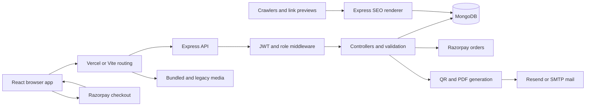

# Evently website audit

Date: 2026-10-26. Original audit plus authorized remediation. The baseline below is retained as evidence; the current status is in the remediation matrix. Source line links in the baseline may have moved.

## Baseline assessment

The original booking and admission flows had release-blocking defects. An authenticated user can obtain a confirmed paid-event booking without payment; payment verification does not bind a payment to the intended purchase; both check-in screens can report admission without saving it. Existing account restrictions are also ineffective against already-issued tokens.

This report records 27 findings, including 15 isolated reproductions. It is not a claim that every possible bug has been found. Implementation is now present for F01–F27. Local regression coverage and the external verification limits are recorded below.

## Original audit coverage and evidence

- Inventoried all **209 tracked files**, including **40 media assets**. The full path/size/category inventory is in [file-inventory.json](X:/EVENTLY/audit/file-inventory.json).
- Traced the active React pages, API client, authentication/role guards, Express routes, controllers, five Mongoose models, mail/PDF/image utilities, deployment configuration, SEO rendering, and maintenance scripts.
- Parsed **118 JavaScript/JSX/module files**, **20 embedded HTML scripts**, **9 JSON files**, and **11 CSS files** without syntax errors. JSON checks include both lockfiles; they do not constitute a dependency security audit.
- Reviewed the archived frontend's API/storage/rendering patterns and parsed its scripts. `Public/*.html`, `Public/js`, and `Public/admin` are not mounted as the live frontend. Old HTML links are redirected by the React application. Archive-only behavior is not presented as a live-site vulnerability.
- Media files were inventoried and active literal media paths checked; every image/video was not visually inspected. One referenced image is missing.
- Ignored environment/backup files, live credentials, generated tickets, dependency internals, and Git object storage were not exhaustively inspected. Relevant installed OAuth code was inspected to validate F14/F15. No production database, account, email, or payment was modified.

### Original audit checks

| Check | Result | What it establishes |
| --- | --- | --- |
| Existing `node scripts/check-js.js` | Pass; 117 `.js` files checked in the working tree | JavaScript syntax only; includes generated output and excludes JSX |
| Vite production build | Pass; 5,920 modules transformed | Current frontend bundles successfully with installed dependencies |
| Compiled Tailwind namespace/property audit | Pass | No mismatches detected by the repository's CSS checker |
| Repository inventory/parser/media checker | Pass parsing; one missing media path | Counts and details saved in `audit/file-inventory.json` |
| Isolated defect probes | 15 reproduced | Saved in `audit/probe-results.json`; these assert current defects, not correct behavior |
| 21st UI checker | Unavailable | Package download failed with `ENOTFOUND registry.npmjs.org` |
| Browser preview | Incomplete | Browser tool timed out reaching the local preview; no visual/mobile/accessibility runtime pass is claimed |
| Real MongoDB integration/concurrency, Google login, Razorpay test checkout/webhooks, mail delivery | Not run | External and multi-request behavior still needs controlled integration testing |
| Dependency vulnerability scan / production deployment inspection | Not completed | No conclusion about current CVEs or deployed configuration |

## Remediation status — 2026-10-26

The user authorized fixes, retained Razorpay test mode, and limited 21st removal to
Evently. No 21st dependency or runtime integration exists in the project. Local
checks pass; a complete deployed payment/Google/email test is still required.

| Finding | Implemented behavior | Verification and limits |
| --- | --- | --- |
| F01 | Direct booking is free-only; paid passes require captured payment | HTTP and MongoDB integration; free Chrome checkout |
| F02 | Immutable purchase binds owner, event, seats, amount, currency, answers and provider order | Signature/amount/quantity/account checks; concurrent replay; simulated paid Chrome checkout |
| F03 | Both admission screens request saved check-in and use the server result; scanner pauses until its result popup is acknowledged with OK and plays the supplied success/error MP3 | Concurrent API scans; Chrome scanner with a ticket absent from its roster, reuse after refresh, acknowledgement lock, delayed/stale frames, actual MP3 playback, network failure and mute. Physical camera/speaker acceptance pending; see audit/scanner-browser-results.txt |
| F04 | Every protected request reads the current account role, status and verification | Stale administrator token and suspended-user regression; UI refreshes account state |
| F05 | All registration question types and organizer editing are connected | Required answers/types tests; actual checkout/editor browser tests |
| F06 | Free checkout skips Razorpay | API idempotency and browser assertion that Checkout never opens |
| F07 | Rejected, archived and closed events cannot be purchased; frontend cutoff matches server | API restrictions; Indian start-time/end-of-day boundary tests |
| F08 | Transactional image attachment validates ownership and retains shared/historical references | Foreign attachment rejected; shared reference survives removal; magic-byte validation |
| F09 | Nonnegative two-decimal prices, integer capacities and bounded content | Model tests and capacity-below-sales HTTP rejection |
| F10 | Seats, booking and purchase commit in one transaction | Real isolated MongoDB replica set; replay, last-seat race and injected booking-insert failure |
| F11 | Only confirmed bookings can be scanned or downloaded | Pending/cancelled API checks; fully refunded passes revoked |
| F12 | Duplicate question suffixes stay inside 32 characters | Duplicate-key normalization and idempotence test |
| F13 | Payment verification queries the authenticated purchase owner | Cross-account retry rejected without returning booking data |
| F14 | Absolute Google callback derives from FRONTEND_URL; start/callback use same origin | Actual localhost Google login passed after correcting the matching client's redirect URI; deployment still pending |
| F15 | Google account restrictions, browser-bound one-use state and HttpOnly handoff exchange | State absence/mismatch/replay tests; owner confirmed actual Google login and verified local account was observed |
| F16 | Crypto OTPs, persistent five-attempt cap/cooldown, route limits, bounded contact/upload input | OTP cap/consumption, validation and polling-limit regressions; deployed proxy/shared-limit configuration pending |
| F17 | Durable purchase recovery, capture checks, signed webhooks, refund retry and full-refund revocation | Actual TEST Checkout/background recovery and full refunds passed. Genuine payment.captured, order.paid and refund.processed notifications returned 200; with browser closed and worker deferred, webhook created one booking, then refund cancelled it and restored seats. Local signed replay also passed |
| F18 | Unsold events archive; confirmed-booking events cannot be deleted/hidden; purchase snapshots preserve details | Organizer/admin deletion rejection, archival/list checks and immutable snapshot test |
| F19 | Role/status allowlists, safe account serialization and administrator continuity policy | Invalid role, safe-field response and administrator-demotion rejection; current admins require owner maintenance |
| F20 | Description IDs resolve; mobile dialog focuses, traps, restores and makes background inert | Chrome description lookup, repeated Tab, Escape, backdrop and focus restoration; human screen-reader check pending |
| F21 | Upload batches respect decoded/encoded bytes and count; unused files retain TTL cleanup | Four large GIF fixtures partition within both server limits; real device animated-image workflow not exhaustively tested |
| F22 | Specific purchase status, accurate email state, confirmed-only QR and authenticated PDF download | Real TEST purchase refresh/PDF download passed; refunded pass hidden and PDF denied. Brevo reports the authorized sample-PDF email delivered; recipient confirmed the PDF opens |
| F23 | Date means on/after and city also matches venue | HTTP regression with a later date and venue-only match |
| F24 | Removed missing After Hour image reference | Current repository/media inventory reports no missing literal active media |
| F25 | Unknown crawler pages 404, clubs get their metadata, DB failures 503; dynamic sitemap is authoritative | HTTP metadata/status tests and removal of stale static sitemap |
| F26 | Repeatable isolated unit, integration and real-browser regression suites | See latest evidence files and WORK_LOG.md for final counts |
| F27 | Legacy deletion only after all event saves; cleanup checks live/historical references and safe paths | Cleanup/reference/path/database-failure tests plus migration control-flow review; no production migration run |

Additional checks: backend and client npm audits report **zero known
vulnerabilities** after updates, including Nodemailer. Production build and
compiled CSS audit pass. Screenshots were inspected at desktop and mobile
viewports. These are bounded checks, not a guarantee against every bug or attack.
The Three.js chunk warning and Mongoose deprecation warnings remain non-failing.

### Updated flows and endpoints

- Payment: create durable Purchase → server order → captured verification or
  signed webhook/recovery worker → transactional Booking/seat allocation →
  queued ticket email. Unavailable inventory leads to a full-refund attempt.
- New GET /api/payments/purchases/:id is owner-only and returns that purchase's
  state. POST /api/payments/webhook validates raw-body HMAC before processing.
- GET /api/events/:id/manage is restricted to the current organizer or admin;
  public event detail no longer exposes rejected/archived events.
- Google state and handoff records live in AuthHandoff with expiry. POST
  /api/auth/google/exchange consumes the cookie once; bearer tokens never enter
  redirect query strings. Callback is now on the FRONTEND_URL origin.
- Purchase and AuthHandoff are new collections; Booking gains snapshots, purchase
  uniqueness and delivery state. Existing production data was not changed.

### External release requirements

See [DEPLOY.md](X:/EVENTLY/DEPLOY.md) and [.env.example](X:/EVENTLY/.env.example).
The local webhook secret has now been generated; the owner must configure the
matching secret on the host and Razorpay dashboard and
update Google's allowed callback to the website origin. Verify an actual
Razorpay test payment/capture, webhook recovery and refund, deployed Google login,
and email delivery before release. MongoDB transactions and unique indexes must
be available. No live keys were substituted, real charge made, production
migration run, or site deployment performed.

## Original prioritized findings

Severity: **Critical** means payment/access integrity can be bypassed; **High** means a core flow, authorization rule, or durable record can fail; **Medium** means a meaningful validation, UX, accessibility, or operational defect; **Low** means a narrower presentation/edge-case issue. “Reproduced” means locally isolated code execution with mocks or actual model validation, not a production exploit.

### F01 — Critical — Paid-event booking bypasses payment

**Evidence:** Reproduced. [Bookingroute.js:6](X:/EVENTLY/routes/Bookingroute.js:6), [bookingController.js:96](X:/EVENTLY/Controllers/bookingController.js:96).

`POST /api/bookings` requires a token but neither verifies payment nor restricts the event to a zero price. The controller creates a confirmed booking and QR, then increments sold seats. The probe obtained a confirmed booking worth Rs 10,000 without a payment ID. This also inflates booking-based revenue.

**Required outcome:** Only a strictly validated free-event path may issue without payment. Paid issuance must require a verified purchase bound to the current account. Test paid rejection and free success through the actual HTTP route.

### F02 — Critical — Payment is not bound to the purchased event, quantity, amount, or account

**Evidence:** Reproduced. [paymentController.js:178](X:/EVENTLY/Controllers/paymentController.js:178), [paymentController.js:245](X:/EVENTLY/Controllers/paymentController.js:245), [paymentController.js:315](X:/EVENTLY/Controllers/paymentController.js:315).

Order creation stores no local purchase record. Verification authenticates an order/payment signature supplied by the caller, but trusts the separately supplied event and ticket count. It never checks the provider amount/currency or retrieves a server-stored purchase. A valid tuple for a cheap purchase can therefore be submitted for a different, more expensive booking. The probe accepted ten Rs 5,000 tickets for a tuple unbound to that purchase; no provider lookup occurred. This does not require forging Razorpay's signature.

**Required outcome:** Persist an immutable purchase intent with account, event, quantity, integer amount, currency, and answers; verify against it and captured payment state. Reject changes and cross-account use. Razorpay's [integration instructions](https://razorpay.com/docs/payments/payment-gateway/web-integration/standard/integration-steps/) explicitly use the server's order ID for signature verification.

### F03 — High — Check-in screens report success without persisting admission

**Evidence:** Reproduced. [Scanner.jsx:337](X:/EVENTLY/client/src/routes/organizer/Scanner.jsx:337), [EventBookings.jsx:216](X:/EVENTLY/client/src/routes/organizer/EventBookings.jsx:216), [bookingController.js:366](X:/EVENTLY/Controllers/bookingController.js:366).

Both screens call `verifyTicket({ bookingId })`, which defaults to `preview`. The server returns a valid preview without updating the booking; the screens locally set `checkedIn: true` and display success. Reloads and other devices still see the ticket as unused. The scanner also relies on a previously fetched roster, so a newly purchased ticket can be rejected until that roster refreshes.

**Required outcome:** Explicitly confirm admission for the selected event, check the returned state, and display the authoritative saved booking. Verify refresh persistence, duplicate scans, simultaneous devices, and a booking purchased after the scanner opens.

### F04 — High — Suspension, bans, and role changes do not invalidate existing access

**Evidence:** Reproduced token acceptance. [authMiddleware.js:20](X:/EVENTLY/middleware/authMiddleware.js:20), [auth.js:396](X:/EVENTLY/routes/auth.js:396).

Middleware validates the JWT and trusts its embedded account ID/role without reading current account state. Tokens last seven days. A suspended/banned user can continue authenticated operations; a demoted organizer/admin retains the previous privileges until expiry. The probe confirms that authorization uses the signed role without any account lookup.

**Required outcome:** Enforce current account status and effective permissions, with a defined revocation mechanism. Test a previously issued token immediately after suspension, ban, role demotion, and account removal.

### F05 — High — Required registration questions cannot be completed in the active checkout

**Evidence:** Reproduced. [EventDetail.jsx:139](X:/EVENTLY/client/src/routes/EventDetail.jsx:139), [api.js:405](X:/EVENTLY/client/src/lib/api.js:405), [paymentController.js:167](X:/EVENTLY/Controllers/paymentController.js:167).

The backend supports registration questions, but the active event checkout renders none and the API helper sends no answers. An event containing a required question fails order creation. The React event editor also lacks question/ticket-layout controls for the backend features. Verification separately discards `resolveAnswers` errors, so a direct verification request can bypass question requirements.

**Required outcome:** Carry validated answers through the form and immutable purchase record, enforce them on issuance, and expose supported organizer controls or explicitly retire the feature. Test all supported question types and required/optional combinations.

### F06 — High — Free-event checkout uses a paid order with amount zero

**Evidence:** Reproduced zero-amount provider request. [EventDetail.jsx:139](X:/EVENTLY/client/src/routes/EventDetail.jsx:139), [paymentController.js:178](X:/EVENTLY/Controllers/paymentController.js:178).

The checkout always opens the payment flow, including free events. The server sends zero paise to Razorpay instead of using a safe free-registration path. Razorpay's [order API documentation](https://github.com/razorpay/markdown-docs/blob/master/api/orders/create.md) specifies a minimum amount of 100 paise. Provider rejection was not executed live.

**Required outcome:** A free event completes without opening Razorpay; paid events never use that free path. Test both alongside F01.

### F07 — High — Hidden/rejected and past events remain directly bookable

**Evidence:** Reproduced a booking for a past rejected event. [events.js:128](X:/EVENTLY/routes/events.js:128), [bookingController.js:19](X:/EVENTLY/Controllers/bookingController.js:19), [paymentController.js:140](X:/EVENTLY/Controllers/paymentController.js:140).

The public detail lookup is unrestricted by status, and both booking paths lack an event-status/date eligibility rule. Hiding a rejected event from the list does not stop access or ticket issuance by ID. Pending visibility is an explicit compatibility choice in the code; the concrete defect is inconsistent detail/purchase enforcement, particularly rejected events.

**Required outcome:** Define the purchasable states and cutoff time, then enforce them consistently at lookup, order creation, and final issuance. Test changes made while checkout is open.

### F08 — High — Image deletion ignores ownership and shared references

**Evidence:** Reproduced deletion filter. [eventController.js:88](X:/EVENTLY/Controllers/eventController.js:88), [eventController.js:99](X:/EVENTLY/Controllers/eventController.js:99).

Events accept any syntactically valid stored image key. Retention/deletion uses that key without checking its owner or whether another event still references it. Reusing an image in two events and removing it from one deletes the other event's artwork. An organizer can also attach a publicly visible key to an event they own and later remove it to trigger deletion of another organizer's image. Retention errors are swallowed, which can leave a used upload eligible for TTL expiry.

**Required outcome:** Authorize image attachment, preserve referenced images, and make retention failures observable/recoverable. Test shared images, foreign owners, replacement, deletion, and TTL behavior.

### F09 — Medium — Server validation permits invalid prices and capacities

**Evidence:** Reproduced with actual Mongoose validation. [Events.js:204](X:/EVENTLY/models/Events.js:204), [eventController.js:193](X:/EVENTLY/Controllers/eventController.js:193).

The event schema accepts negative prices and fractional seat counts. Client checks do not protect the API. Monetary input is multiplied by 100 without an enforced integer-paise policy, and many content/array limits exist only in the browser. This can create records that checkout cannot process or capacities that do not represent tickets.

**Required outcome:** Shared server-side validation for nonnegative integer capacity, finite supported prices, integer provider amounts, content lengths, and array bounds. Test direct API requests as well as forms.

### F10 — High — Booking and seat updates can diverge on failure

**Evidence:** Reproduced insertion followed by a simulated reservation error. [bookingController.js:96](X:/EVENTLY/Controllers/bookingController.js:96), [bookingController.js:118](X:/EVENTLY/Controllers/bookingController.js:118), [eventController.js:440](X:/EVENTLY/Controllers/eventController.js:440).

Direct booking inserts a confirmed record before updating sold seats. It deletes the booking if the update returns no match, but not if the update throws. The probe returned HTTP 500 while leaving the inserted booking. Payment issuance also uses separate reserve/insert/compensate steps; compensation failures are suppressed. Capacity edits validate against an earlier read rather than the atomic update condition, leaving a race with new purchases.

**Required outcome:** A durable transaction/state transition or recoverable reservation mechanism preserves booking/capacity invariants. Test database failures at each boundary and concurrent capacity edits/purchases against real MongoDB; mocks do not establish concurrency correctness.

### F11 — Medium — Pending bookings qualify as valid passes

**Evidence:** Reproduced. [bookingController.js:270](X:/EVENTLY/Controllers/bookingController.js:270), [bookingController.js:444](X:/EVENTLY/Controllers/bookingController.js:444).

Ticket download and scan checks exclude cancelled records rather than requiring confirmed records. A booking in the supported `pending` state is reported as valid and can be admitted. Current creation paths mostly write confirmed records, so exposure depends on existing/future pending records.

**Required outcome:** Only confirmed, eligible bookings can download an active pass or be admitted. Verify every booking status and concurrent cancellation/admission.

### F12 — Low — Duplicate long question keys fail validation

**Evidence:** Reproduced. [registrationFields.js:93](X:/EVENTLY/utils/registrationFields.js:93).

The sanitizer truncates keys to 32 characters, then appends a uniqueness suffix without shortening the base. Two identical maximum-length keys produce a 34-character key, rejected by the schema.

**Required outcome:** Generate unique keys within the maximum length. Verify duplicates, preexisting suffixes, and repeated sanitization.

### F13 — Medium — Payment replay can return another account's booking

**Evidence:** Reproduced. [paymentController.js:262](X:/EVENTLY/Controllers/paymentController.js:262).

The idempotent lookup finds a booking by payment/order ID and returns it without verifying the requesting account. Anyone already possessing that valid payment/signature tuple can retrieve the other account's returned booking, including QR data. This is conditional on access to a valid tuple; it is not unauthenticated enumeration by booking ID.

**Required outcome:** Bind retry handling to the original purchase/account and return a minimal authorized response. Test same-account retries and cross-account reuse.

### F14 — High, deployment-dependent — OAuth can generate an HTTP callback behind the HTTPS proxy

**Evidence:** Reproduced URL resolution using installed Passport code. [passport.js:9](X:/EVENTLY/config/passport.js:9), [server.js:24](X:/EVENTLY/server.js:24).

Google's callback is relative. Neither Express nor the strategy configures proxy trust. For a plain HTTP connection behind a TLS-terminating proxy, Passport ignores `X-Forwarded-Proto: https` and resolves the callback to HTTP. This conflicts with the HTTPS callback documented for deployment and can cause a redirect URI mismatch. The actual deployed proxy/Google configuration was not inspected.

**Required outcome:** Use a validated explicit callback origin or narrowly configured proxy trust. Test the resolved redirect URI in the real deployment topology and a complete Google login.

### F15 — High — Google login bypasses account restrictions; OAuth request binding is absent

**Evidence:** Reproduced acceptance of a suspended account by the strategy. [passport.js:15](X:/EVENTLY/config/passport.js:15), [auth.js:426](X:/EVENTLY/routes/auth.js:426).

The Google strategy returns an existing user regardless of status, and the callback issues a token without the password-login suspension/ban checks. No OAuth `state` setting/store is configured; the installed library defaults to a null state store, leaving login-response binding absent. Separately, the seven-day bearer token is placed in a redirect query string, which creates avoidable exposure to URL logging/history; actual leakage was not tested.

**Required outcome:** Apply the same account policy to every login method, validate a one-time OAuth transaction, and exchange a short-lived handoff code rather than exposing the long-lived bearer token in a URL. Test suspended/banned accounts and unsolicited/replayed callbacks.

### F16 — High — Authentication and public writes have no application-level abuse limits

**Evidence:** Source confirmed. [auth.js:224](X:/EVENTLY/routes/auth.js:224), [auth.js:287](X:/EVENTLY/routes/auth.js:287), [contact.js:6](X:/EVENTLY/routes/contact.js:6), [server.js:25](X:/EVENTLY/server.js:25).

OTP verification has no attempt limit; resends have no server cooldown; login/contact/upload routes have no mounted limiter despite the installed dependency. OTP generation uses `Math.random`. The email-check route discloses registration/verification state. Contact records have no server length/email-format limits beyond required strings and the global body cap. These enable guessing, repeated mail delivery, and storage/CPU abuse. Any upstream protections are unknown.

**Required outcome:** Per-account/IP limits and cooldowns, cryptographic OTP generation, bounded validated public input, and a considered account-disclosure policy. Test limits without sending real bulk email.

### F17 — High — Successful payments can be left without a booking or recovery path

**Evidence:** Source confirmed; live failure injection pending. [paymentController.js:277](X:/EVENTLY/Controllers/paymentController.js:277), [EventDetail.jsx:156](X:/EVENTLY/client/src/routes/EventDetail.jsx:156), [payments.js:10](X:/EVENTLY/routes/payments.js:10).

Seats are reserved only after the payment callback. A last-seat race can therefore return 409 after authorization/payment. A closed tab, network interruption, or server failure can prevent verification altogether. There is no persistent purchase attempt, webhook handler, capture-status check, reconciliation job, or refund workflow in this repository. A valid signature alone is used to issue a ticket, even though capture status matters. Actual merchant auto-capture settings are unknown. Razorpay recommends [captured-payment checks and server-side webhook confirmation](https://razorpay.com/docs/payments/payment-gateway/web-integration/standard/integration-steps/).

**Required outcome:** Durable, idempotent fulfillment and recovery with a defined sold-out/refund policy. Exercise tab closure, duplicate/out-of-order webhooks, delayed capture, last-seat races, and provider success followed by database failure.

### F18 — High — Event deletion breaks historical bookings

**Evidence:** Source confirmed. [eventController.js:519](X:/EVENTLY/Controllers/eventController.js:519), [adminController.js:93](X:/EVENTLY/Controllers/adminController.js:93), [bookingController.js:168](X:/EVENTLY/Controllers/bookingController.js:168).

Deletion removes an event without resolving its bookings, preserving an immutable event snapshot, or handling paid attendees. Populated event references then become null; tickets lose event context and cannot follow normal event admission. Organizer deletion also removes images; the separate admin deletion path leaves retained images behind.

**Required outcome:** Define cancellation/archival behavior, preserve purchased-event details, and maintain consistent image cleanup. Test deleting/archiving an event with paid, free, admitted, and cancelled bookings.

### F19 — Medium — Admin role updates bypass validation and expose unnecessary credential fields

**Evidence:** Source confirmed. [adminController.js:145](X:/EVENTLY/Controllers/adminController.js:145), [adminController.js:168](X:/EVENTLY/Controllers/adminController.js:168).

Role changes use `findByIdAndUpdate` without an allowlist or `runValidators`, can report success for a missing user, and lack a last-admin safeguard. Role/status responses serialize the full user document, including password/OTP hashes; the user list excludes password but not verification hashes. This is exposure to privileged callers, not a public password endpoint.

**Required outcome:** Validated roles, consistent not-found errors, protected administrative continuity, and explicit safe response fields. Test invalid roles, missing users, self/last-admin changes, and response serialization.

### F20 — Medium — Form descriptions and mobile dialog focus are incomplete

**Evidence:** Source confirmed; assistive-technology testing pending. [Field.jsx:88](X:/EVENTLY/client/src/components/ui/Field.jsx:88), [Field.jsx:118](X:/EVENTLY/client/src/components/ui/Field.jsx:118), [Nav.jsx:217](X:/EVENTLY/client/src/components/layout/Nav.jsx:217).

Controls reference generated helper/error IDs through `aria-describedby`, but the corresponding paragraphs have no IDs. Screen readers cannot resolve those descriptions. The mobile navigation declares a modal dialog but has no initial focus, focus trap, background inertness, or return-focus handling. Escape handling alone does not complete modal keyboard behavior.

**Required outcome:** Valid description targets and consistent dialog focus management. Verify with keyboard-only use and a screen reader at mobile and desktop widths.

### F21 — Medium — Image batches exceed the server limits despite individually valid files

**Evidence:** Source confirmed. [images.js:39](X:/EVENTLY/client/src/lib/images.js:39), [images.js:208](X:/EVENTLY/client/src/lib/images.js:208), [eventController.js:21](X:/EVENTLY/Controllers/eventController.js:21).

The browser batches four images by count, but the server permits only 8 MiB decoded per request and 12 MiB JSON. Four accepted 3 MiB GIFs exceed both the decoded limit and, after base64 expansion, the body limit. Even four images at the 2.6 MiB target exceed the decoded limit. Later batch failure also leaves earlier uploads awaiting TTL cleanup.

**Required outcome:** Batch by encoded/decoded byte budget as well as count, and provide a clear retry/cleanup path. Verify boundary sizes and animated GIFs.

### F22 — Medium — Success and ticket screens can misrepresent booking/delivery state

**Evidence:** Source confirmed. [BookingSuccess.jsx:87](X:/EVENTLY/client/src/routes/BookingSuccess.jsx:87), [BookingSuccess.jsx:234](X:/EVENTLY/client/src/routes/BookingSuccess.jsx:234), [BookingTicket.jsx](X:/EVENTLY/client/src/components/bookings/BookingTicket.jsx).

Without navigation state, the success page selects the latest booking rather than a specific booking and labels it confirmed without checking its status. It promises an emailed PDF even when verification returns `emailed: false`. The ticket modal offers a QR image download while the authenticated PDF download helper is unused; cancelled-state presentation is also incomplete. This makes recovery and support harder precisely when payment/email delivery fails.

**Required outcome:** Address a specific booking, render authoritative status and delivery outcome, and expose the intended authenticated ticket download. Test refresh/direct navigation, cancelled/pending bookings, and mail failure.

### F23 — Medium — Search labels do not match API semantics

**Evidence:** Source confirmed. [SearchOverlay.jsx:73](X:/EVENTLY/client/src/components/search/SearchOverlay.jsx:73), [SearchOverlay.jsx:82](X:/EVENTLY/client/src/components/search/SearchOverlay.jsx:82), [events.js:35](X:/EVENTLY/routes/events.js:35).

The date control says “On or after” but sends `date`, which the server interprets as that single day using both start and end bounds. The city helper promises city-or-venue matching, while the city filter searches only `location`. Users can be told there are no matches when later dates or matching venues exist.

**Required outcome:** Align query parameters and labels with the selected product semantics. Test later-date and venue-only matches, including the intended event timezone.

### F24 — Low — After Hour gallery references a missing asset

**Evidence:** Filesystem check. [clubs.js:93](X:/EVENTLY/client/src/data/clubs.js:93).

`/Media/AfterHour/4.webp` is referenced but not present in tracked media. That gallery slot cannot load from this repository.

**Required outcome:** Supply the intended asset or remove the invalid entry; verify all gallery URLs.

### F25 — Medium — Bot-rendered SEO pages have incorrect fallback behavior

**Evidence:** Source confirmed. [seo.js:366](X:/EVENTLY/routes/seo.js:366), [seo.js:721](X:/EVENTLY/routes/seo.js:721), [seo.js:739](X:/EVENTLY/routes/seo.js:739).

Unknown non-detail paths fall back to home copy with HTTP 200. Valid club detail routes get generic club metadata/logo rather than each venue's data. An event query failure can fall through to a 404 if the readiness flag still says the database is ready, describing a temporary error as a missing event. A separate static sitemap also contains `/about`, which the SPA does not implement; which sitemap is served must be checked on the deployed host.

**Required outcome:** Correct 404/503 distinctions, venue-specific metadata, and one verified sitemap source. Compare browser and bot requests on production-style hosting.

### F26 — Medium — Current test coverage cannot establish core behavior

**Evidence:** Source confirmed. [package.json:13](X:/EVENTLY/package.json:13), [check-js.js](X:/EVENTLY/scripts/check-js.js), [client/package.json](X:/EVENTLY/client/package.json).

`npm test` performs syntax checks, not behavior tests, and the client has no test script. Payment, role changes, seat races, scan persistence, and failure recovery lack an automated regression suite. A successful build therefore coexists with the defects above. The new audit probes intentionally reproduce failures; they are not yet acceptance tests.

**Required outcome:** Convert relevant probes to correct-behavior tests as fixes land, add HTTP/MongoDB integration tests for critical transitions, and run focused browser acceptance flows. Keep external-service checks explicitly separate.

### F27 — High when the destructive option is used — Image migration deletes before saving new references

**Evidence:** Source confirmed; destructive mode was not executed. [migrateEventImages.js:102](X:/EVENTLY/scripts/migrateEventImages.js:102), [migrateEventImages.js:167](X:/EVENTLY/scripts/migrateEventImages.js:167).

With `--commit --delete-files`, `importFile` removes the legacy file before the containing event saves its replacement URL. A later validation/database failure can leave the stored event pointing to a deleted file. The default mode retains files, so this affects the explicit destructive migration option.

**Required outcome:** Defer deletion until references are durably committed and verified, with restart/recovery support. Test failure injection in a temporary fixture directory and isolated database.

## Data and API flow map

### Runtime boundaries

The browser talks to same-origin paths. Vercel proxies API/media requests to the configured backend; local Vite has equivalent API/media proxies. Express gates `/api` requests on database readiness. It serves React's built assets/fallback when present, `/Media`, and legacy `/uploads`. Generated ticket PDFs are intentionally not publicly mounted; downloads use authorization.

### Persistent data

| Model | Data and writers | Readers / dependent flows |
| --- | --- | --- |
| User | Email/name, password hash or OAuth marker, verification fields, role/status; signup/OAuth/admin write | Login, `/me`, authorization claims, organizer/booking populations, admin |
| Event | Details, price/capacity/sold count, organizer, status, image paths, lineup, ticket config and questions | Public listing/detail, orders/bookings, scanner roster, dashboards, SEO |
| Booking | User/event references, ticket count/total, payment/order IDs, QR/ticket ID, answers, status/check-in | My bookings, ticket PDF, event roster/scans, revenue summaries |
| EventImage | Binary content/type, key, owner, expiry | Public image endpoint, event attachment/cleanup, migration |
| Contact | Name/email/subject/message and timestamp | Contact/support forms create; admin inbox reads/deletes |

There is no separate durable order/payment-attempt, seat-reservation, refund, email-job, or audit-trail model. Those absences matter to the failure paths described above, rather than automatically requiring a particular architecture.

### Main user journeys

| Journey | Data flow | Main findings |
| --- | --- | --- |
| Email signup | Browser validation → domain/MX check → bcrypt + pending User → hashed OTP + email → verification → login JWT | F16; real delivery not tested |
| Password login/session | Credentials → status/password checks → seven-day JWT → local storage → bearer API requests → embedded role guards | F04, F16 |
| Google login | Passport redirect → Google callback → find/create User → JWT in frontend redirect → local storage | F14, F15 |
| Browse/search | Query controls → `/events` filters → Event list → public detail | F07, F23 |
| Paid checkout | Detail/quantity → create provider order → browser Checkout → signature verification → reserve seats → Booking/QR → PDF/mail → success | F02, F05, F09, F10, F13, F17, F22 |
| Direct/free booking | Authenticated booking POST → Event lookup → Booking/QR → seat increment | F01, F06, F07, F10 |
| View/download ticket | My bookings → populated event → modal QR; API PDF verifies owner/organizer/admin and regenerates PDF | F11, F18, F22 |
| Organizer create/edit | Prepare images → base64 upload → EventImage → event save/retain → old image cleanup | F05, F08, F09, F10, F12, F21 |
| Organizer admission | Load owned event/roster → decode or enter ticket → verify preview/confirm → displayed attendance | F03, F11 |
| Admin operations | Embedded JWT role → lists/aggregates → event moderation/deletion, account role/status changes, message deletion | F04, F18, F19 |
| Contact/support | Form → Contact insert → admin inbox; no email notification on contact submission | F16; profile-edit help text also promises an unavailable action |
| Clubs/editorial pages | Local curated club/FAQ/page data → images/maps/React route metadata | F24, F25 |
| Crawlers | User-agent rewrite → SEO renderer → static copy or Event lookup → HTML/schema; dynamic sitemap | F25 |

### Endpoint inventory

Access below describes intended route checks. F04 affects every JWT-protected route. Event ownership is checked inside the relevant controllers; a role guard alone is not the only protection.

| Method and path | Access / operation |
| --- | --- |
| POST `/api/auth/register` | Public; create pending user and send OTP |
| POST `/api/auth/check-email` | Public; registration/domain checks |
| POST `/api/auth/verify-email-otp` | Public; verify pending user |
| POST `/api/auth/resend-email-otp` | Public; replace OTP and email |
| POST `/api/auth/login` | Public; password login |
| GET `/api/auth/me` | JWT; current account profile |
| GET `/api/auth/google` | Public; OAuth start |
| GET `/api/auth/google/callback` | OAuth result; token redirect |
| GET `/api/events` | Public; filtered list |
| GET `/api/events/:id` | Public; event detail |
| GET `/api/events/my` | Organizer/admin; owned events |
| GET `/api/events/dashboard/stats` | Organizer/admin; organizer totals |
| POST `/api/events/uploads` | Organizer/admin; database image upload |
| POST `/api/events` | Organizer/admin; create event |
| PUT `/api/events/:id` | Organizer owner/admin; update event |
| DELETE `/api/events/:id` | Organizer owner/admin; delete event/images |
| GET `/api/events/:id/bookings` | Organizer owner/admin; event roster |
| POST `/api/payments/create-order` | JWT; create Razorpay order |
| POST `/api/payments/verify` | JWT; signature verification and ticket issuance |
| POST `/api/bookings` | JWT; direct ticket issuance |
| GET `/api/bookings/my` | JWT; current account bookings |
| GET `/api/bookings/:id/ticket` | Booking owner, event organizer, or admin; PDF |
| POST `/api/bookings/verify-ticket` | Organizer/admin plus ownership checks; preview or admission |
| POST `/api/contact` | Public; contact record |
| GET `/api/images/:key` | Public; image bytes with cache headers |
| GET `/api/admin/dashboard` | Admin; aggregate dashboard |
| GET `/api/admin/events` | Admin; event list |
| DELETE `/api/admin/events/:id` | Admin; delete event through separate implementation |
| PATCH `/api/admin/events/:id/approve` | Admin; approve |
| PATCH `/api/admin/events/:id/reject` | Admin; reject |
| GET `/api/admin/events/pending` | Admin; pending list |
| GET `/api/admin/messages` | Admin; contact messages |
| DELETE `/api/admin/messages/:id` | Admin; delete contact message |
| GET `/api/admin/users` | Admin; account list |
| PATCH `/api/admin/users/:id/role` | Admin; role update |
| PATCH `/api/admin/users/:id/status` | Admin; status update |
| GET `/api/admin/stats` | Admin; analytics |
| GET `/api/profile` | JWT; legacy/debug token-payload response |
| GET `/sitemap.xml`, `/robots.txt` | Public; crawl controls and discovery |
| `/seo/render/*` | Public middleware; bot HTML renderer |

### Frontend route coverage

- Public: home, events/list/detail, clubs/list/detail, experience, login/signup/OTP, contact, FAQ, support, privacy, terms, and not-found.
- Account: profile, my bookings, booking success.
- Organizer: dashboard, create/edit event, event bookings, scanner.
- Admin: dashboard, events, users, inbox, analytics.
- Shared: API/auth hooks, navigation/search/footer, form controls, dialogs/carousels/feedback, ticket display, SEO, motion/Three scenes, styles and tokens.
- Legacy `.html` URLs are compatibility redirects; archived HTML is not an additional supported live application.

## Additional risks and product gaps to evaluate

These are follow-up observations, not additional reproduced defects:

- Public and administrative lists are unpaginated; whole result sets and some QR payloads grow with the database. Load testing and suitable indexes/projections are needed before scale claims.
- The build warns about a **1,076.24 kB** uncompressed Three.js chunk, approximately **300.10 kB gzip**. It is deferred and motion/device safeguards exist; a mobile performance regression has not been measured. Profile before deciding whether the visuals need changing.
- The support page now correctly describes the profile as read-only. Password recovery remains a product gap outside F01–F27.
- The development launcher now passes its API port through VITE_API_TARGET. Deployment instructions were updated.
- Image uploads now validate MIME magic bytes and cap per-owner storage. Full media decoding/security fuzzing and multi-instance quota load testing remain future coverage.
- Ticket PDF layout, non-Latin names, printer output, delivery timeouts/retries, and simultaneous PDF generation still need rendered/runtime verification. Existing PDF text normalization already handles the rupee symbol; this audit does not report that as a defect.
- Baseline security headers are set on Express responses. Vercel/frontend headers, upstream controls and a durable privileged-action audit trail still need deployment/operational review.

## Recommended implementation sequence

1. **Purchase integrity:** F01, F02, F13, F17; define one authoritative purchase lifecycle and free/paid separation.
2. **Admission and access:** F03, F04, F11, F14, F15, F16, F19.
3. **Data integrity:** F07, F08, F09, F10, F18, F27.
4. **Complete customer/organizer flows:** F05, F06, F12, F21, F22, F23.
5. **Accessibility, media, SEO, and measured performance:** F20, F24, F25 plus follow-up observations.
6. **Regression coverage throughout:** F26 is addressed with each fix, rather than postponed until all implementation ends.

For each user-assigned task: read `WORK_LOG.md` → select the relevant finding and acceptance criteria → reproduce → implement → run focused tests → evaluate → repeat if a test exposes a defect → update the log with evidence and remaining work. Live-service or environment blockers must remain explicit. The user authorized the fixes above. Continue from the current work log, preserving test mode and recorded external limits.

## Integration follow-up — Brevo migration

See WORK_LOG.md and INTEGRATION_SETUP.md for the current setup task. Resend was
replaced with Brevo. The IP restriction is resolved, the active verified sender
is event@event-ly.in, and one authorized random-content email with a TEST-only
PDF was reported delivered. Google localhost login passed after the owner fixed
the exact matching OAuth client's redirect URI. The backend suite now passes
40 tests, including four Brevo and two webhook-relay checks.

Two actual Razorpay TEST Checkout payments captured and fulfilled exactly once;
one recovered with the Evently tab closed before bank success and no browser
verification request. Both test refunds processed. Locally signed refund replay
checks cancelled the passes, restored seats once and blocked PDF access. These
earlier checks did not establish provider webhook delivery. The owner subsequently
saved the Test mode webhook with payment.captured and order.paid; refund.processed
and refund.failed were added and verified. A third TEST payment, with the browser
closed and its background check deferred, was fulfilled exactly once through
genuine capture/order notifications (HTTP 200). A genuine refund.processed
notification (200) cancelled the pass and restored the seat; PDF access returned
409. All three test payments are fully refunded. The email recipient also
confirmed the PDF opens. Local integration acceptance checks now pass. A real
refund failure was not induced; failure/retry has isolated regression coverage.
No production database, live payment or deployment was used. Evidence:
audit/brevo-smoke.json, audit/google-live-status.json, audit/razorpay-live-test.json
and audit/razorpay-webhook-test.json.
